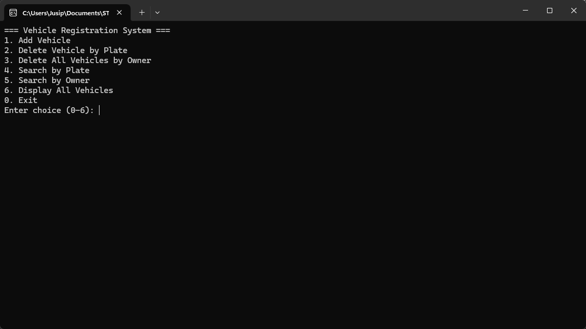
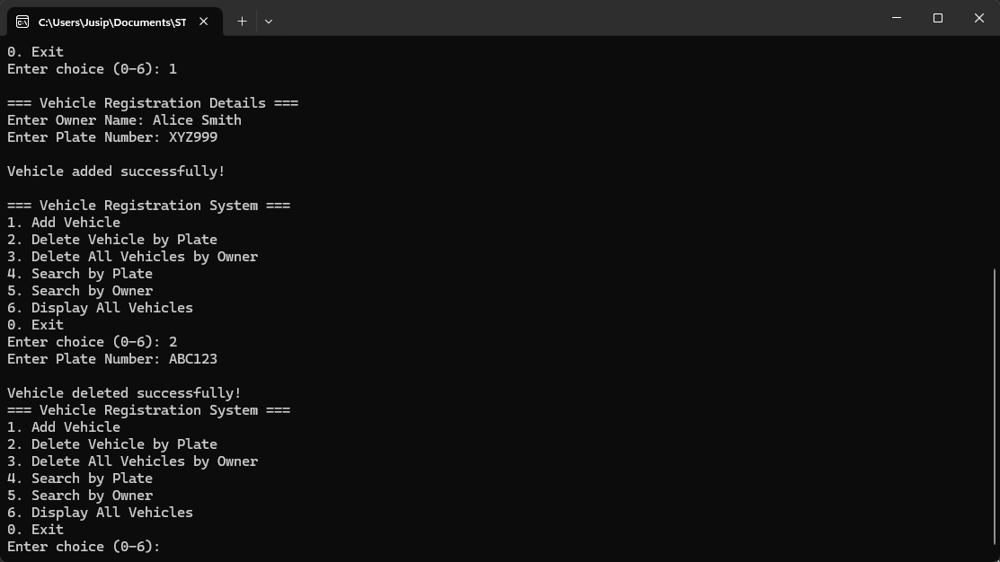
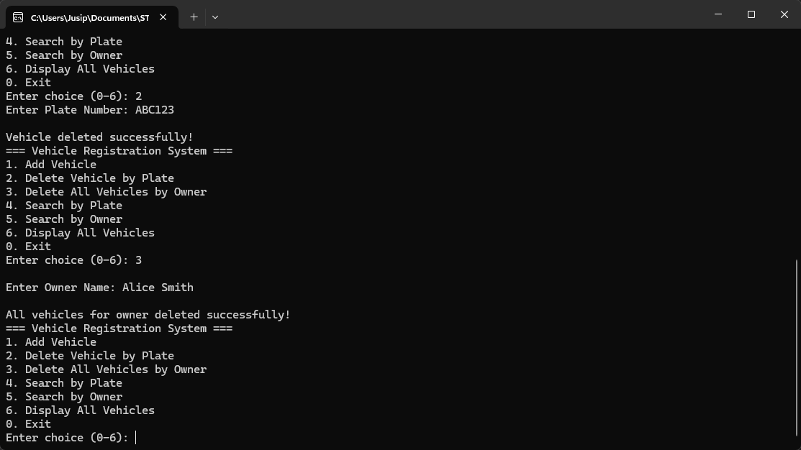
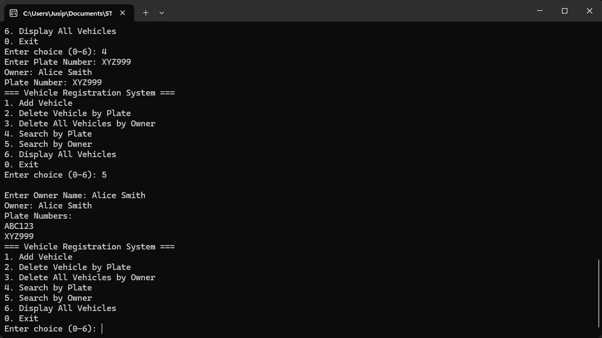
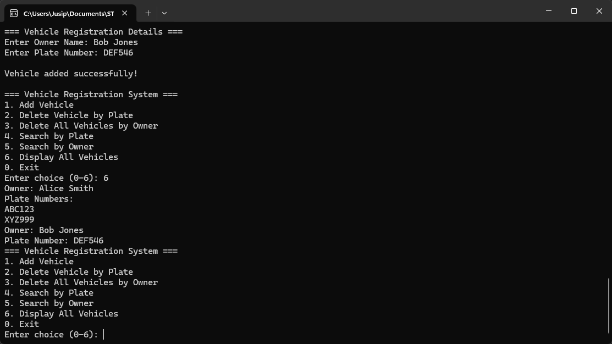

<div align="center">

# CS 318 Projects

**Course projects for CS 318 (Architecture and Organization), AY 2025–2026: a menu-driven vehicle registry written in x86 assembly.**

-blue)


</div>

## Overview

This repository collects the work for CS 318 (AY 2025–2026). It currently contains one program, the **Vehicle Registration System (VRS)**: a console application written entirely in 32-bit NASM assembly. It keeps vehicle records (owner name and plate number) in memory and offers a text menu to add, delete, search and list them.

**Skills demonstrated**

- IA-32 assembly programming with NASM (`section .data`, `.bss`, `.text`)
- Calling C runtime functions (`printf`, `scanf`) from assembly using the cdecl convention and explicit stack frames
- Fixed-size parallel arrays and index arithmetic (`index * 64`, `index * 32`)
- Hand-written string comparison and copy loops, with NUL padding
- Compacting an array by shifting records down after a delete
- Bounded input with `scanf` scan-sets (`%63[^\n]`, `%31[^\n]`)

## Table of Contents

- [Getting Started](#getting-started)
- [Repository Structure](#repository-structure)
- [Programs](#programs)
- [Using the Vehicle Registration System](#using-the-vehicle-registration-system)
- [Sample Results](#sample-results)
- [Known Limitations](#known-limitations)

## Getting Started

### Requirements

- [NASM](https://www.nasm.us/) 2.x
- A 32-bit GCC that can link Windows objects (for example MinGW's `gcc`)
- Windows with PowerShell (the program uses the 32-bit Windows symbol names `_main`, `_printf`, `_scanf`)

### Compile and run (Windows, PowerShell)

```powershell
cd final-project\vehicle-registration-system
nasm -f win32 vrs.asm -o vrs.obj
gcc vrs.obj -o vrs.exe
.\vrs.exe
```

`*.obj` and `*.exe` files are listed in [.gitignore](.gitignore), so build output is not committed.

### Compile and run (Linux, optional)

The source uses Windows-style underscore-prefixed C symbols. On Linux, assemble as 32-bit ELF, rename those symbols in the object file, and link with a 32-bit-capable GCC (`gcc -m32`, which needs the 32-bit C library installed):

```sh
cd final-project/vehicle-registration-system
mkdir -p build
nasm -f elf32 vrs.asm -o build/vrs.o
objcopy --redefine-sym _main=main --redefine-sym _printf=printf \
        --redefine-sym _scanf=scanf --redefine-sym _atoi=atoi \
        build/vrs.o build/vrs-linux.o
gcc -m32 -no-pie build/vrs-linux.o -o build/vrs
./build/vrs
```

The `build/` folder is git-ignored.

## Repository Structure

```text
cs318-projects/
├── .gitignore
├── README.md
└── final-project/
    └── vehicle-registration-system/
        ├── vrs.asm                       # full program source
        └── screenshots/                  # Windows terminal screenshots
            ├── main-menu.png
            ├── add-vehicle.png
            ├── add-second-vehicle.png
            ├── delete-by-plate.png
            ├── delete-by-owner.png
            ├── search-by-plate.png
            ├── search-by-owner.png
            └── display-all.png
```

## Programs

### Final project

| Program | Description | Concept practiced | Last modified |
| --- | --- | --- | --- |
| [Vehicle Registration System](final-project/vehicle-registration-system/vrs.asm) | Menu-driven registry of up to 20 vehicles (owner + plate): add, delete by plate, delete all by owner, search by plate, search by owner, display all grouped by owner. | Assembly with C runtime calls, parallel arrays, string handling | 2025-11-06 |

> **About the dates:** these are last-modified dates taken from the git history (the commit date of the file). Git does not keep a file's original on-disk timestamp, so the real authoring dates may be earlier. Where no date can be determined, a table would show "—".

## Using the Vehicle Registration System

The program shows a menu and reads a choice from `0` to `6`:

| Choice | Action |
| --- | --- |
| `1` | Add a vehicle. Prompts for owner name, then plate number. A plate that already exists is rejected and the plate prompt repeats. |
| `2` | Delete the vehicle with a given plate number. |
| `3` | Delete every vehicle belonging to a given owner. |
| `4` | Search by plate number and show the owner and plate. |
| `5` | Search by owner name and list that owner's plate(s). |
| `6` | Display all vehicles, grouped by owner (in order of first appearance). |
| `0` | Exit. |

**Data layout** (in the `.bss` section):

- `owner_names`: 20 slots × 64 bytes, so an owner name holds at most 63 characters
- `plate_numbers`: 20 slots × 32 bytes, so a plate number holds at most 31 characters
- `vehicle_count`: number of records currently stored

Records in the two arrays line up by index. Deleting a record shifts later records down so the arrays stay contiguous.

## Sample Results

The output below was captured from a real run of the program assembled from [vrs.asm](final-project/vehicle-registration-system/vrs.asm), with the typed input shown after each prompt. To keep it short, each repeat of the 8-line main menu after the first is replaced by `[main menu redisplayed]`; everything else is unedited.

<details>
<summary><strong>Vehicle Registration System</strong>: add, display, search, duplicate plate, delete, exit</summary>

```text
=== Vehicle Registration System ===
1. Add Vehicle
2. Delete Vehicle by Plate
3. Delete All Vehicles by Owner
4. Search by Plate
5. Search by Owner
6. Display All Vehicles
0. Exit
Enter choice (0-6): 1

=== Vehicle Registration Details ===
Enter Owner Name: Alice Smith
Enter Plate Number: ABC123

Vehicle added successfully!

[main menu redisplayed]
Enter choice (0-6): 1

=== Vehicle Registration Details ===
Enter Owner Name: Alice Smith
Enter Plate Number: XYZ999

Vehicle added successfully!

[main menu redisplayed]
Enter choice (0-6): 1

=== Vehicle Registration Details ===
Enter Owner Name: Bob Jones
Enter Plate Number: DEF456

Vehicle added successfully!

[main menu redisplayed]
Enter choice (0-6): 6
Owner: Alice Smith
Plate Numbers:
ABC123
XYZ999
Owner: Bob Jones
Plate Number: DEF456
[main menu redisplayed]
Enter choice (0-6): 4
Enter Plate Number: XYZ999
Owner: Alice Smith
Plate Number: XYZ999
[main menu redisplayed]
Enter choice (0-6): 5

Enter Owner Name: Alice Smith
Owner: Alice Smith
Plate Numbers:
ABC123
XYZ999
[main menu redisplayed]
Enter choice (0-6): 1

=== Vehicle Registration Details ===
Enter Owner Name: Bob Jones
Enter Plate Number: ABC123

Error: Plate number already exists. Enter a different plate.
Enter Plate Number: BOB777

Vehicle added successfully!

[main menu redisplayed]
Enter choice (0-6): 2
Enter Plate Number: ABC123

Vehicle deleted successfully!
[main menu redisplayed]
Enter choice (0-6): 3

Enter Owner Name: Alice Smith

All vehicles for owner deleted successfully!
[main menu redisplayed]
Enter choice (0-6): 4
Enter Plate Number: ABC123

No vehicle found.
[main menu redisplayed]
Enter choice (0-6): 6
Owner: Bob Jones
Plate Numbers:
DEF456
BOB777
[main menu redisplayed]
Enter choice (0-6): 0
```

</details>

<details>
<summary><strong>Screenshots</strong> (Windows terminal)</summary>

| | |
| --- | --- |
|  |  |
|  |  |
|  |  |
|  |  |

</details>

## Known Limitations

- **No persistence.** All records live in memory and are lost when the program exits.
- **20-record cap.** Adding a 21st vehicle prints no error and the record is silently not stored (the prompts are still shown).
- **Exact, case-sensitive matching.** Owner and plate comparisons are byte-for-byte, so `alice smith` does not match `Alice Smith`.
- **Fragile menu input.** If the menu choice is not a number, or standard input ends (EOF) after a choice has been read, `scanf` fails and the menu is reprinted endlessly until the process is stopped.
- **Over-long input is not discarded.** Names longer than 63 characters or plates longer than 31 are cut off by `scanf`, but the leftover characters stay in the input and are read by the next prompt.
- **Windows-oriented build.** The source uses 32-bit Windows symbol names (`_main`, `_printf`, `_scanf`), so building on Linux needs the symbol-renaming step shown above.
