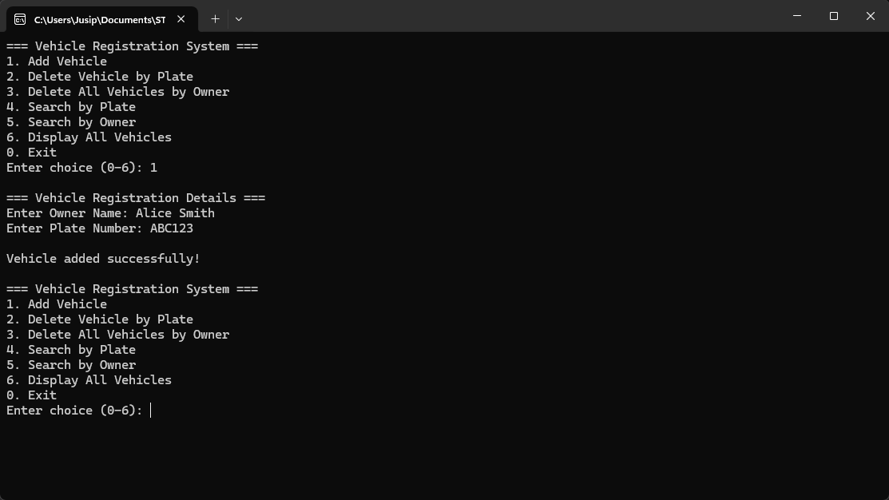
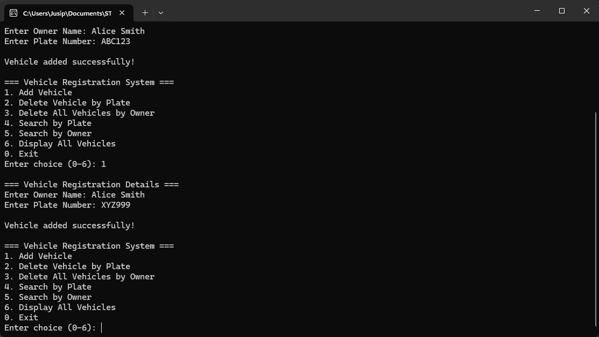
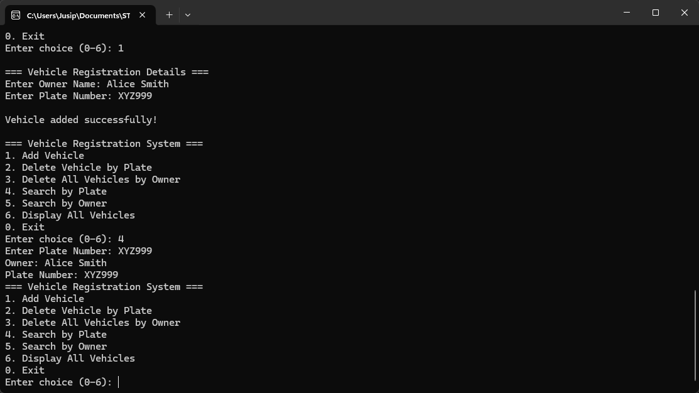

# Vehicle Registration System (VRS)

> **Project Status:** 🚧 Currently in active development. Documentation and screenshots being updated. Last updated: November 6, 2025.

A small command-line Vehicle Registration System implemented in x86 assembly (NASM) for the CS318 final project: Architecture and Organization.

This program demonstrates basic data storage and manipulation in memory using arrays, string handling, and a text menu interface implemented in NASM for 32-bit Windows (win32) and linked with MinGW's GCC.

## Features

- Add a vehicle record (Owner name + Plate number)
- Delete a vehicle by plate number
- Delete all vehicles by owner name
- Search for a vehicle by plate number
- Search for vehicles by owner name (lists plates)
- Display all registered vehicles (grouped by owner)

## Tech stack / Requirements

- NASM (Netwide Assembler) targeting 32-bit object files (nasm -f win32)
- MinGW (GCC) to link the produced object file into an executable
- Windows (tested with PowerShell)

Minimum tested versions: NASM 2.x, MinGW-w64 / GCC. Adjust commands if using a different toolchain.

## Project limits and data layout

- Maximum records: 20 vehicles
- Owner name max length: 63 characters (stored in 64-byte slots)
- Plate number max length: 31 characters (stored in 32-byte slots)

Data is stored in two parallel arrays in the program's .bss section: `owner_names` (20 × 64 bytes) and `plate_numbers` (20 × 32 bytes). `vehicle_count` tracks the current number of records.

## Files

- `VRS.asm` — main NASM source implementing the menu and all features.
- `README.md` — this file.

## How to compile (PowerShell)

Open PowerShell in the project folder (where `VRS.asm` lives) and run:

```powershell
nasm -f win32 VRS.asm
gcc -o VRS VRS.obj
```

Notes:

- `nasm -f win32` produces `VRS.obj` which is then linked by `gcc` (MinGW) to create `VRS.exe`.
- If your GCC or assembler are not on PATH, run them using full paths or update PATH.

## How to run (PowerShell)

After compiling, run the program from the same directory:

```powershell
.\VRS.exe
# or simply
VRS
```

You can also distribute or double-click `VRS.exe` from Explorer, but a console window will appear and the menu will be shown there.

## Usage (menu)

When you run the program you'll see a menu with choices 0–6. Example flow:

- `1` — Add Vehicle: you'll be prompted for owner full name and plate number. Plate numbers must be unique.
- `2` — Delete Vehicle by Plate: enter a plate number to delete the matching record.
- `3` — Delete All Vehicles by Owner: enter an owner name to remove every record that matches exactly.
- `4` — Search by Plate: enter a plate number to display that vehicle's owner and plate.
- `5` — Search by Owner: enter an owner name to list that owner's plates.
- `6` — Display All Vehicles: shows all owners and their plates grouped.
- `0` — Exit

String matching is exact (case-sensitive) and compares bytes until a terminating NUL. Leading/trailing spaces are handled according to how the C `scanf` format in the program reads input.

## How it works (with screenshots)

Here's a visual walkthrough of all features. Screenshots are stored in the `screenshots/` folder.

### 1. Main Menu

When you start the program, you'll see the main menu:

```
=== Vehicle Registration System ===
1. Add Vehicle
2. Delete Vehicle by Plate
3. Delete All Vehicles by Owner
4. Search by Plate
5. Search by Owner
6. Display All Vehicles
0. Exit

Enter choice (0-6): _
```


### 2. Adding Vehicles (Option 1)

Let's add a vehicle for Alice Smith:

```
=== Vehicle Registration Details ===
Enter Owner Name: Alice Smith
Enter Plate Number: ABC123

Vehicle added successfully!
```



Add another vehicle for the same owner:

```
=== Vehicle Registration Details ===
Enter Owner Name: Alice Smith
Enter Plate Number: XYZ999

Vehicle added successfully!
```



### 3. Deleting by Plate Number (Option 2)

Delete Alice's first vehicle:

```
Enter Plate Number: ABC123

Vehicle deleted successfully!
```


### 4. Deleting by Owner (Option 3)

Remove all vehicles for an owner:

```
Enter Owner Name: Alice Smith

All vehicles for owner deleted successfully!
```


### 5. Searching by Plate (Option 4)

Find a specific vehicle:

```
Enter Plate Number: XYZ999

Owner: Alice Smith
Plate Number: XYZ999
```



### 6. Searching by Owner (Option 5)

List all vehicles for an owner:

```
Enter Owner Name: Alice Smith

Owner: Alice Smith
Plate Numbers:
ABC123
XYZ999
```


### 7. Display All Records (Option 6)

See all vehicles grouped by owner:

```
Owner: Alice Smith
Plate Numbers:
ABC123
XYZ999

Owner: Bob Jones
Plate Number: DEF456
```


## Known limitations and possible improvements

- Simple in-memory storage only — data is lost when the program exits. Adding file persistence would be a useful improvement.
- String comparisons are exact and case-sensitive; consider normalizing case for more flexible searches.
- No advanced input validation beyond fixed-size buffers — could add trimming and length checks before copy.
- Limited to 20 records; consider implementing dynamic storage or on-disk data structures.
